# My Favorite Places : Clusterisation de conteneurs

Projet du module **Clusterisation de conteneurs** (ESGI Lyon, 5ESGI AL + IABD).
<br/>Le but : prendre l'application **My Favorite Places** (un client React et une API Node.js/Express qui enregistre ses données dans PostgreSQL), la mettre dans des conteneurs, l'orchestrer, puis la faire tenir la charge.

Ce README raconte la démarche, étape par étape (retour au [sommaire général](../README.md)).
<br/>À chaque nouvelle étape du module, une section vient s'ajouter à la suite.

## Sommaire

**TD1**

1. [Test initial avec Bruno](#1-test-initial-avec-bruno)
2. [Dockerisation du serveur](#2-dockerisation-du-serveur)
3. [Dockerisation du client](#3-dockerisation-du-client)
4. [Orchestration avec Docker Compose](#4-orchestration-avec-docker-compose)
5. [Communication entre les services](#5-communication-entre-les-services)
6. [Démarrage, redémarrage et images légères](#6-démarrage-redémarrage-et-images-légères)

**TD2**

- [Prérequis : images publiées sur un registry](#prérequis--images-publiées-sur-un-registry)
- [Exercice 2 : création du cluster Docker Swarm](#exercice-2--création-du-cluster-docker-swarm)
- [Exercice 3 : tests du cluster](#exercice-3--tests-du-cluster)

**TD3**

- [Exercice 1 : déployer Traefik](#exercice-1--déployer-traefik)
- Exercice 2 : déployer une autre application → dans [`voting-app/`](../voting-app/README.md)

## Structure du dossier

```
mfp/
├── client/                          # application React (Vite)
├── server/                          # API Node.js / Express / TypeORM
├── compose.yml                      # lance la base, le serveur et le client ensemble
├── mfp-bruno-api-test-collection/   # collection Bruno pour tester l'API
├── swarm/                           # cluster Docker Swarm (DinD) et stacks (TD2, TD3)
└── screenshots/                     # captures d'écran
```

Les workflows GitHub Actions qui publient les images restent à la racine du dépôt, dans [`.github/workflows/`](../.github/workflows/) : GitHub ne les lit qu'à cet endroit.

## Environnement de travail

| Outil | Version | Remarque |
|---|---|---|
| Docker Engine | 29.7.2 | installé dans WSL2 (Ubuntu 24.04), sans Docker Desktop |
| Docker Compose | v5.5.0 | plugin `docker compose` |
| Node.js / Yarn | 22.23.2 / 1.22.22 | installés dans WSL via nvm |
| Bruno | 4.2.1 | client API installé sous Windows |

Toutes les commandes se lancent dans un terminal **WSL (Ubuntu)**, depuis ce dossier `mfp/`.

---

# TD1

## 1. Test initial avec Bruno

**Objectif (TD1, étape 1) :** avant de toucher à Docker, on vérifie que l'API fonctionne en la lançant en local avec `yarn dev`.

### 1.1 Prérequis : lancer d'abord une base PostgreSQL

Première chose à savoir : le serveur refuse de démarrer **tant qu'il ne trouve pas PostgreSQL**.
<br/>Sans base, il affiche `🚨 unable to connect to db` et ne se met jamais à écouter sur le port 3000.

Il va chercher la base avec les paramètres écrits dans `server/src/datasource.ts` :

| Paramètre | Valeur |
|---|---|
| host | `localhost` |
| port | `5432` (port par défaut) |
| username | `postgres` |
| password | `supersecret` |
| database | `postgres` |

Bonne nouvelle : il crée lui-même les tables `user` et `address` au démarrage (`synchronize: true`).
<br/>Une base vide lui suffit donc.

On démarre alors une base PostgreSQL dans un conteneur, avec les identifiants qu'il attend :

```bash
docker run -d --name mfp-db \
  -e POSTGRES_PASSWORD=supersecret \
  -p 5432:5432 \
  postgres:17
```

- `-e POSTGRES_PASSWORD=supersecret` : le mot de passe que le serveur va utiliser.
- `-p 5432:5432` : rend la base joignable sur `localhost`, puisque le serveur tourne pour l'instant en dehors de Docker.

Un petit `docker ps` confirme que `mfp-db` tourne bien (`Up`, port `5432`) :

<p align="center">
  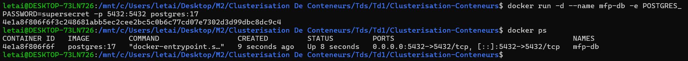
</p>

### 1.2 Lancer l'API en mode développement

```bash
cd server
yarn install
yarn dev
```

`yarn dev` lance `nodemon src/index.ts`.
<br/>On sait que tout va bien quand la console affiche :

```
✅ connected to PgSQL db
🚀 server started on port 3000
```

<p align="center">
  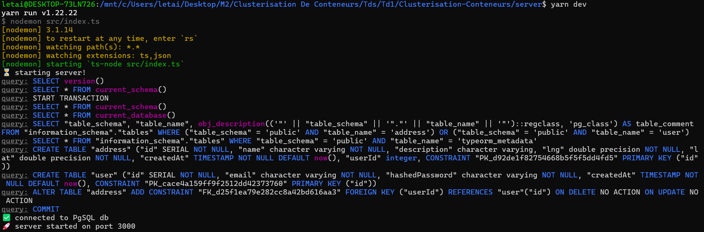
</p>

### 1.3 Routes de l'API

L'API répond sur `http://localhost:3000`, et toutes ses routes commencent par `/api` :

| Méthode | Route | Authentification | Rôle |
|---|---|---|---|
| POST | `/api/users` | non | créer un utilisateur (`email`, `password`) |
| POST | `/api/users/tokens` | non | se connecter et obtenir un token |
| GET | `/api/users/me` | oui | profil de l'utilisateur connecté |
| POST | `/api/addresses` | oui | ajouter une adresse |
| GET | `/api/addresses` | oui | lister ses adresses |
| POST | `/api/addresses/searches` | oui | rechercher ses adresses autour d'un point (rayon en km) |

Pour les routes protégées, il faut joindre son token dans le header `Authorization: Bearer <token>`.

### 1.4 Collection Bruno

Les requêtes de test sont rangées dans `mfp-bruno-api-test-collection/` : il suffit d'ouvrir ce dossier dans Bruno. On les lance dans l'ordre :

| # | Requête | Résultat attendu |
|---|---|---|
| 01 | Create user | `200`, l'utilisateur créé |
| 02 | Login (get token) | `200`, `{ "token": "..." }` |
| 03 | My profile | `200`, l'utilisateur connecté |

Notre utilisateur de test : **ahmed test 1**, email `ahmedtest@gmail.com`, mot de passe `azerty123`.

### 1.5 Résultats des tests

#### 01 — Créer un utilisateur

`POST http://localhost:3000/api/users`

```json
{
  "email": "ahmedtest@gmail.com",
  "password": "azerty123"
}
```

<p align="center">
  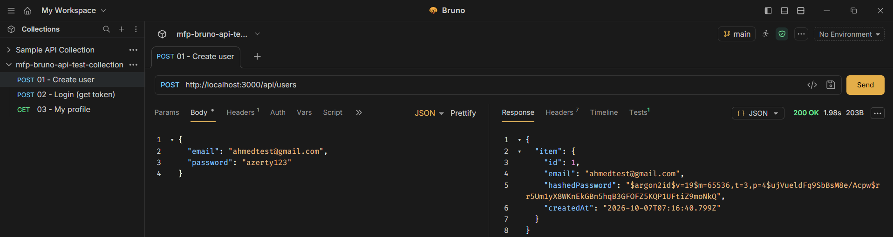
</p>

#### 02 — Se connecter (obtenir un token)

`POST http://localhost:3000/api/users/tokens` (même corps que la requête 01)

<p align="center">
  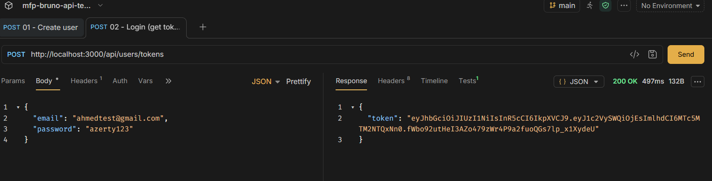
</p>

#### 03 — Mon profil

`GET http://localhost:3000/api/users/me` (header `Authorization: Bearer {{token}}`)

<p align="center">
  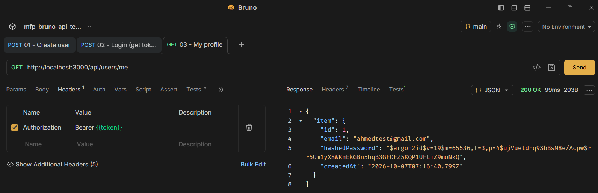
</p>

---

## 2. Dockerisation du serveur

**Objectif (TD1, étape 2) :** faire tourner l'API dans un conteneur, à côté de la base, puis refaire les tests avec Bruno.

### 2.1 Le Dockerfile du serveur

Fichier `server/Dockerfile` :

```dockerfile
FROM node:24-alpine3.24

WORKDIR /app

COPY package.json yarn.lock ./
RUN yarn install --frozen-lockfile

COPY tsconfig.json ./
COPY src src
RUN yarn build

EXPOSE 3000

CMD ["yarn", "start"]
```

- On installe les dépendances en premier. Tant que `package.json` et `yarn.lock` ne bougent pas, Docker garde cette étape en cache, et les reconstructions suivantes vont beaucoup plus vite.
- On ne copie que ce qui sert vraiment (`src` et `tsconfig.json`), pas tout le dossier.
- `yarn build` traduit le TypeScript en JavaScript pendant la construction de l'image. Au démarrage, `yarn start` n'a plus qu'à lancer ce JavaScript.

Au passage, `server/.dockerignore` évite d'envoyer `node_modules` et `dist` à Docker.

> Les captures de cette étape ont été prises avec l'image `node:22`, qu'on a ensuite remplacée par `node:24-alpine3.24` (plus récente et plus légère).
> <br/>Plus tard, ce Dockerfile a été découpé en 3 étapes pour alléger l'image : voir [6.3](#63-alléger-les-images).

### 2.2 Adapter la connexion à la base

Premier piège : dans un conteneur, `localhost` veut dire **le conteneur lui-même**. Le serveur cherchait donc la base chez lui… et forcément, il ne la trouvait pas.

Pour s'en sortir, `server/src/datasource.ts` lit maintenant ses paramètres dans des **variables d'environnement**, en gardant les anciennes valeurs par défaut :

```ts
host: process.env.DB_HOST || "localhost",
username: process.env.DB_USER || "postgres",
password: process.env.DB_PASSWORD || "supersecret",
database: process.env.DB_NAME || "postgres",
```

Dans Docker, il suffit alors de donner au serveur le nom du conteneur de la base avec `DB_HOST`.

> Ces variables ont disparu par la suite, avec Docker Compose : voir [4.4](#44-simplification-de-la-connexion-à-la-base).

### 2.3 Lancer la base et le serveur

Pour que deux conteneurs puissent s'appeler par leur nom, ils doivent partager le même **réseau Docker**. On en crée donc un :

```bash
# 1. créer un réseau commun
docker network create mfp-net

# 2. lancer la base sur ce réseau
docker run -d --name mfp-db --network mfp-net \
  -e POSTGRES_PASSWORD=supersecret \
  postgres:17

# 3. construire l'image du serveur
docker build -t mfp-server ./server

# 4. lancer le serveur sur le même réseau
docker run -d --name mfp-server --network mfp-net \
  -e DB_HOST=mfp-db \
  -p 3000:3000 \
  mfp-server

# 5. vérifier
docker ps
docker logs mfp-server
```

- `--network mfp-net` : sur ce réseau, le serveur trouve la base sous le nom `mfp-db`.
- `-e DB_HOST=mfp-db` : c'est ce nom qu'on lui donne pour la base.
- `-p 3000:3000` : l'API reste accessible sur `http://localhost:3000`, pour Bruno.
- La base n'a plus besoin de `-p 5432:5432` : seul le serveur lui parle, et il passe par le réseau Docker.

<p align="center">
  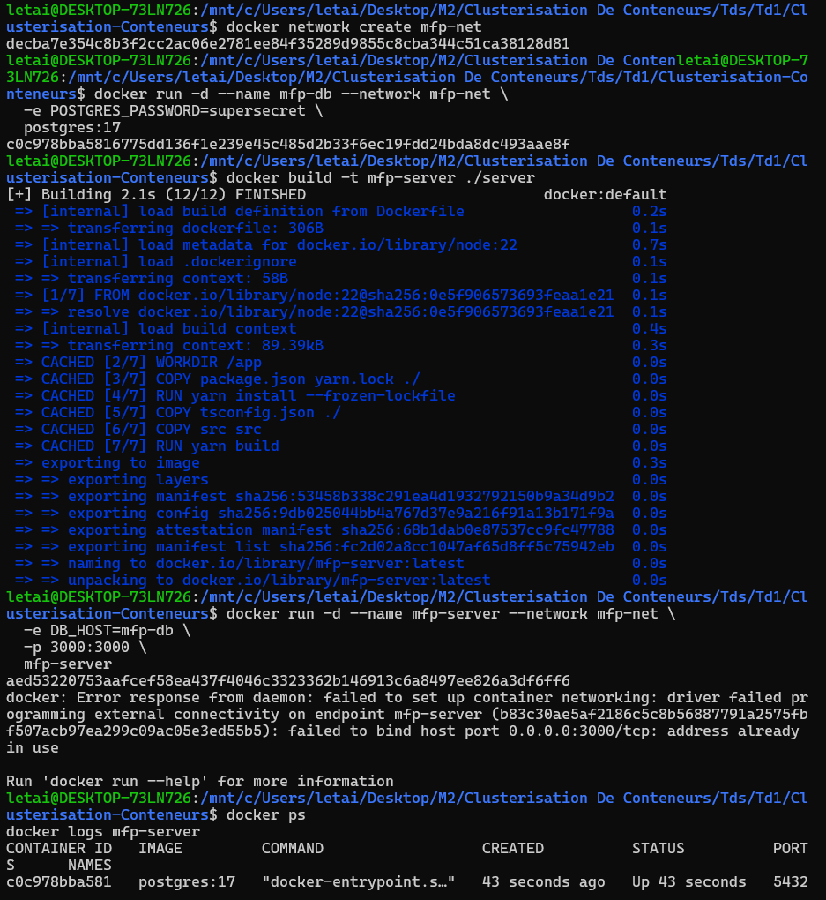
</p>

> **Problème rencontré :** au premier essai, `docker run` a refusé de démarrer avec `address already in use` sur le port 3000.
> <br/>On avait tout simplement oublié le `yarn dev` de l'étape 1, qui tournait encore sur ce port.
> <br/>**Solution :** arrêter `yarn dev` (Ctrl+C), supprimer le conteneur raté (`docker rm -f mfp-server`), puis relancer la commande 4.

Cette fois, les logs du serveur affichent bien :

```
✅ connected to PgSQL db
🚀 server started on port 3000
```

On le voit même créer les tables `user` et `address` dans la base toute neuve.

<p align="center">
  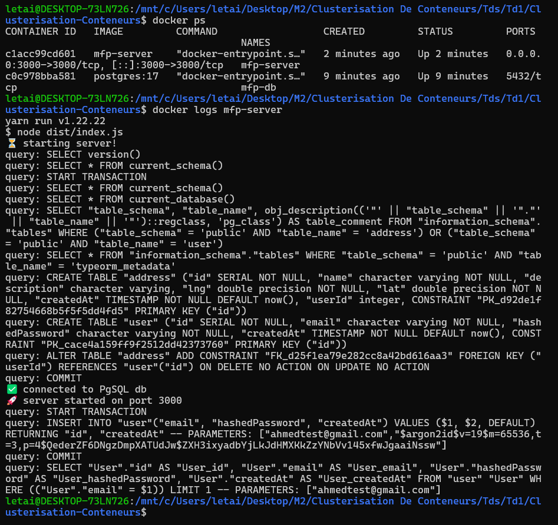
</p>

### 2.4 Test avec Bruno

Rien à changer côté Bruno : grâce à `-p 3000:3000`, le conteneur répond à la même adresse que `yarn dev`.

Comme la base est neuve, on recrée l'utilisateur avec **01 - Create user**, puis on se connecte avec **02 - Login (get token)**. On récupère un `200` et un token : le serveur, depuis son conteneur, retrouve bien l'utilisateur dans `mfp-db`.

<p align="center">
  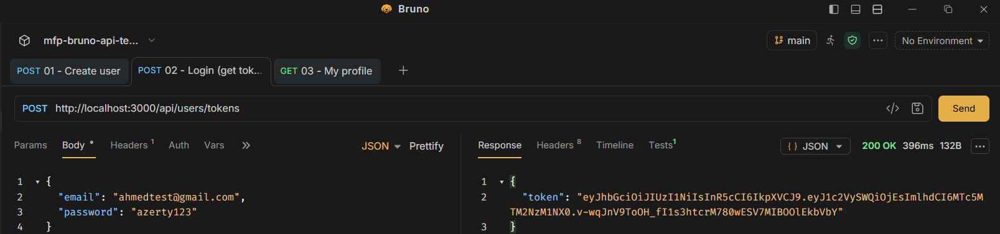
</p>

---

## 3. Dockerisation du client

**Objectif (TD1, étape 4) :** mettre aussi le client React dans un conteneur, et vérifier qu'il arrive à parler au serveur.

### 3.1 Le Dockerfile du client

Fichier `client/Dockerfile` :

```dockerfile
FROM node:24-alpine3.24

WORKDIR /app

COPY package*.json yarn.lock ./
RUN yarn install --frozen-lockfile

COPY tsconfig*.json ./
COPY vite.config.ts ./
COPY index.html ./
COPY public public
COPY src src

EXPOSE 5173

CMD ["yarn", "dev", "--host"]
```

- On reprend la même recette que pour le serveur : les dépendances d'abord, puis uniquement les fichiers utiles.
- Le client tourne avec le serveur de développement de Vite, sur le port `5173`.
- `--host` : sans cette option, Vite n'accepte que les visites venant de l'intérieur du conteneur, et notre navigateur resterait à la porte.

`client/.dockerignore` écarte lui aussi `node_modules` et `dist`.

> Les captures de cette étape ont été prises avec `node:22`, remplacée ensuite par `node:24-alpine3.24`.
> <br/>Plus tard, ce Dockerfile a été remplacé par une version en 3 étapes, où c'est **nginx** qui sert le client : voir [6.3](#63-alléger-les-images).

### 3.2 Adapter l'adresse de l'API

Le client appelle l'API sur `/api/...`, et Vite fait suivre ces appels au serveur (`client/vite.config.ts`). Problème : l'adresse visée était `http://localhost:3000`, et dans le conteneur du client, `localhost`… c'est le client lui-même. Même piège que pour le serveur.

On lit donc cette adresse dans une variable d'environnement :

```ts
target: process.env.API_URL || "http://localhost:3000",
```

> Cette variable a disparu par la suite : dans Docker, c'est maintenant nginx qui fait suivre les appels `/api` au serveur (voir [6.3](#63-alléger-les-images)). `vite.config.ts` pointe désormais vers `http://server:3000`, le nom du service du serveur, exactement comme `db` pour la base.

### 3.3 Lancer le client

La base et le serveur de l'étape 2 doivent toujours tourner.

```bash
# 1. construire l'image du client
docker build -t mfp-client ./client

# 2. lancer le client sur le même réseau que le serveur
docker run -d --name mfp-client --network mfp-net \
  -e API_URL=http://mfp-server:3000 \
  -p 5173:5173 \
  mfp-client

# 3. vérifier
docker ps
docker logs mfp-client
```

- `-e API_URL=http://mfp-server:3000` : Vite sait maintenant où envoyer les appels `/api`.
- `-p 5173:5173` : le site est accessible sur `http://localhost:5173`.

`docker ps` affiche nos 3 conteneurs (`mfp-db`, `mfp-server`, `mfp-client`), tous `Up`.

<p align="center">
  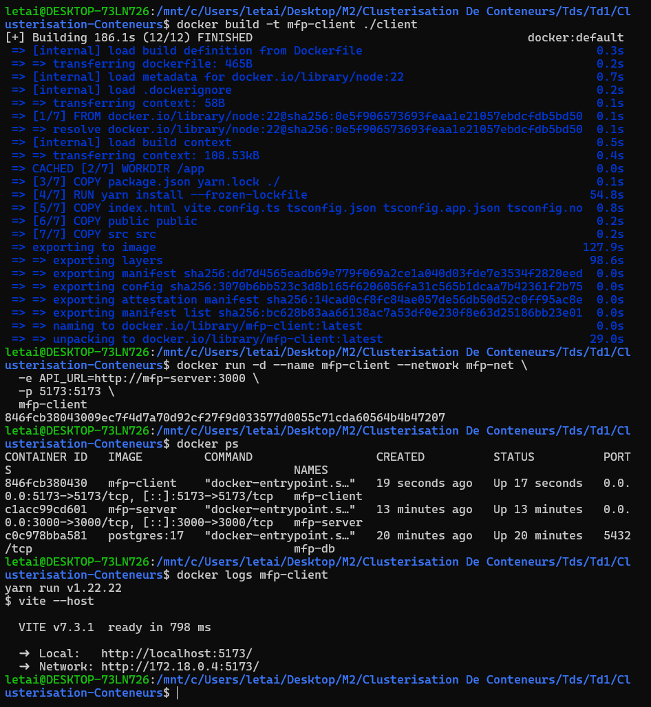
</p>

### 3.4 Test dans le navigateur

On ouvre `http://localhost:5173`, on se connecte avec `ahmedtest@gmail.com` / `azerty123`… et on arrive bien sur le tableau de bord.

<p align="center">
  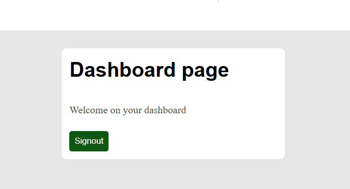
</p>

---

## 4. Orchestration avec Docker Compose

**Objectif (TD1, étape 3) :** en finir avec la longue liste de `docker network` et `docker run`, et tout lancer en une seule commande grâce à un fichier.

### 4.1 Le fichier `compose.yml`

Le fichier `compose.yml`, à la racine du dossier `mfp/`, décrit nos 3 services. Chacun remplace une commande `docker run` qu'on tapait à la main :

| Service | Remplace | Points clés |
|---|---|---|
| `db` | `docker run ... postgres:17` | même utilisateur (`POSTGRES_USER`) et mot de passe que ceux attendus par le serveur ; port `5432` publié |
| `server` | `docker build` + `docker run ... mfp-server` | trouve la base grâce au **nom du service** `db` (voir [4.4](#44-simplification-de-la-connexion-à-la-base)) |
| `client` | `docker build` + `docker run ... mfp-client` | port `5173` publié ; fait suivre les appels `/api` au service `server` (voir [5](#5-communication-entre-les-services)) |

- **Réseau :** plus besoin de le créer, Compose s'en charge. Chaque service y est joignable par son nom (`db`, `server`, `client`).
- **Volume `db-data` :** les données de la base survivent, même si on recrée le conteneur `db`.
- **`depends_on` :** les services démarrent dans l'ordre `db` → `server` → `client`.
- **`healthcheck` sur `db` :** toutes les 2 secondes, `pg_isready` vérifie si PostgreSQL accepte les connexions. Grâce à `condition: service_healthy`, le serveur attend patiemment que la base soit **prête** avant de démarrer.

### 4.2 Lancer l'application

On fait d'abord le ménage : les conteneurs et le réseau créés à la main occupent encore les ports 3000 et 5173.

```bash
docker rm -f mfp-client mfp-server mfp-db
docker network rm mfp-net
```

Puis on lance tout d'un coup :

```bash
docker compose up -d --build
docker compose ps
docker compose logs server
```

- `up` : crée le réseau, le volume et les 3 conteneurs, puis les démarre.
- `-d` : en arrière-plan, pour garder la main sur le terminal.
- `--build` : construit les images du serveur et du client au passage.

> **Problème rencontré :** au départ, avec un simple `depends_on: - db`, le serveur s'arrêtait aussitôt (`unable to connect to db: connect ECONNREFUSED`).
> <br/>En fait, `depends_on` attend seulement que le conteneur de la base soit **démarré**, pas que PostgreSQL soit **prêt** à répondre : le serveur arrivait trop tôt.
> <br/>**Solution :** le `healthcheck` sur `db` et `condition: service_healthy` sur `server` (voir 4.1). On voit alors `mfp-db-1 Waiting` puis `Healthy` avant que le serveur ne démarre.

`docker compose ps` montre les 3 services `Up` (`healthy` pour `db`), et les logs du serveur affichent `connected to PgSQL db` puis `server started on port 3000`.

<p align="center">
  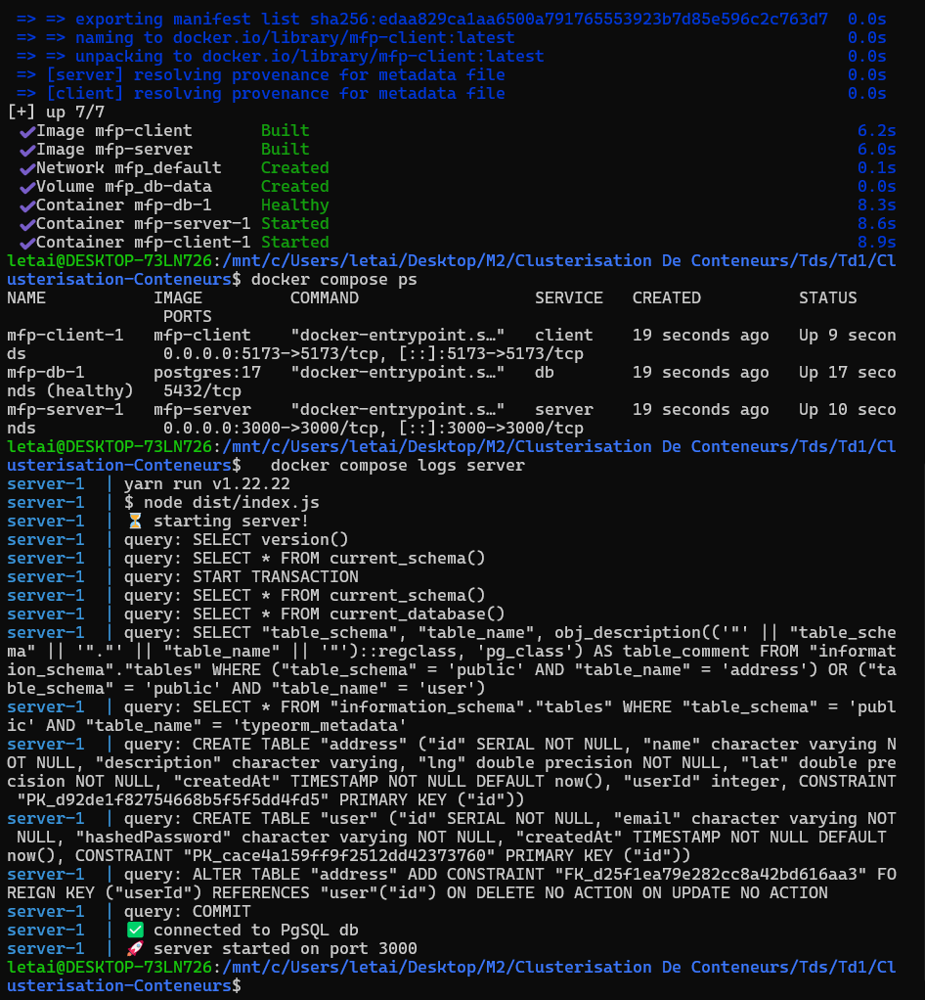
</p>

### 4.3 Test

Nouveau volume, donc base vide : on recrée l'utilisateur avec Bruno (**01 - Create user**), puis on se connecte sur `http://localhost:5173` avec `ahmedtest@gmail.com` / `azerty123`.

<p align="center">
  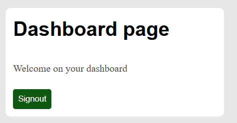
</p>

Pour tout arrêter : `docker compose down`. Le volume `db-data`, et donc les données, restent en place.

### 4.4 Simplification de la connexion à la base

Avec Compose, la base porte toujours le même nom : `db`, celui de son service. Les variables d'environnement de l'étape 2 n'ont donc plus d'intérêt, et on écrit l'adresse directement dans `server/src/datasource.ts` :

```ts
host: "db",
username: "postgres",
password: "supersecret",
database: "postgres",
```

Le revers de la médaille : le serveur ne fonctionne plus que **dans Compose**, là où le nom `db` existe. Les commandes manuelles de l'étape 2 et le `yarn dev` de l'étape 1 ne trouvent plus la base sans retouche.

---

## 5. Communication entre les services

**Question (TD1, étape 5) :** comment la base et le serveur se parlent-ils ? Et le serveur et le front ?

```
 Machine (Windows / WSL)                 Réseau Docker « mfp_default »
 ┌──────────────────────┐              ┌───────────────────────────────────────────────┐
 │ Navigateur ──────────┼─ :5173 ─────►│ client (nginx) ── /api ──► server ──► db       │
 │                      │              │                           :3000      :5432    │
 │ Bruno ───────────────┼─ :3000 ─────►│                           server              │
 └──────────────────────┘              └───────────────────────────────────────────────┘
```

**Base ↔ serveur**
- Les deux conteneurs vivent sur le même réseau, créé par Compose.
- Le serveur appelle la base par son **nom de service**, `db`, sur le port `5432`. Docker se charge de traduire ce nom en adresse.
- Le port `5432` n'est publié que pour pouvoir jeter un œil à la base depuis la machine : le serveur, lui, n'en a pas besoin.

**Front ↔ serveur**
- Le code React tourne **dans le navigateur**, c'est-à-dire sur notre machine, en dehors du réseau Docker : il n'a aucune idée de ce qu'est `server`.
- Le navigateur appelle donc l'API à la même adresse que le site : `http://localhost:5173/api/...`.
- C'est le conteneur `client` qui fait le relais vers le service `server`, par le réseau Docker (d'abord avec Vite, puis avec nginx).
- Bruno, de son côté, va directement voir le serveur sur `http://localhost:3000`, grâce au port `3000` publié.

---

## 6. Démarrage, redémarrage et images légères

**Objectif (TD2) :** rendre le démarrage fiable, faire redémarrer les services tout seuls, et alléger les images.

### 6.1 Démarrer le serveur seulement quand la base est prête

C'est déjà réglé depuis l'étape 4 : `healthcheck` sur `db` et `condition: service_healthy` sur `server` (voir [4.1](#41-le-fichier-composeyml) et [4.2](#42-lancer-lapplication)).

### 6.2 Redémarrage automatique

Dans `compose.yml`, chaque service a maintenant :

```yaml
restart: unless-stopped
```

- Si un service plante et s'arrête tout seul, Docker le **relance automatiquement**.
- Si c'est nous qui l'arrêtons **à la main** (`docker compose stop`), il reste arrêté.

Pour le vérifier, on simule un plantage en tuant le processus Node du serveur, puis on compte combien de fois Docker l'a relancé :

```bash
docker compose exec server pkill -f "node dist/index.js"
docker inspect mfp-server-1 --format 'status={{.State.Status}} restarts={{.RestartCount}}'
# status=running restarts=1

docker compose stop server
docker inspect mfp-server-1 --format 'status={{.State.Status}} restarts={{.RestartCount}}'
# status=exited restarts=1   (arrêt manuel : pas de redémarrage)

docker compose start server
```

### 6.3 Alléger les images

On découpe chaque Dockerfile en **3 étapes** (*multi-stage build*). Seule la dernière devient l'image finale : les outils de construction et le code source restent derrière, dans les étapes précédentes.

| Étape | Rôle |
|---|---|
| `deps` | installe toutes les dépendances |
| `builder` | construit l'application (`yarn build`) |
| `main` | image finale : seulement ce qui sert à lancer l'application |

**Serveur** (`server/Dockerfile`) : l'image finale ne garde que le JavaScript compilé (`dist`) et les dépendances de production (`--production`).

**Client** (`client/Dockerfile`) : `yarn build` transforme l'application React en simples fichiers HTML, CSS et JavaScript. Plus besoin de Node.js pour les servir : un petit serveur web **nginx** fait très bien l'affaire.

Sa configuration se trouve dans `client/nginx.conf`, copié dans l'image :

```nginx
server {
    listen 5173;
    root /usr/share/nginx/html;

    location / {
        try_files $uri $uri/ /index.html;
    }

    location /api/ {
        proxy_pass http://server:3000;
    }
}
```

- `listen 5173` : on garde le même port, l'adresse du site ne change pas.
- `location /` : envoie les fichiers du site. Pour une page comme `/dashboard`, qui n'existe pas vraiment en tant que fichier, nginx renvoie `index.html` et React affiche la bonne page.
- `location /api/` : fait suivre les appels à l'API vers le service `server`. C'est le rôle que tenait Vite avant.

**Résultat :**

| Image | Avant | Après |
|---|---|---|
| `mfp-server` | 477 Mo | **337 Mo** (−140 Mo) |
| `mfp-client` | 1,49 Go | **93 Mo** |

```bash
docker compose up -d --build
docker images
```

---

# TD2

**Objectif :** monter un cluster Docker Swarm sur notre propre PC. Chaque « machine » du cluster est en fait un conteneur **Docker-in-Docker** (DinD), qui embarque son propre Docker.

## Prérequis : images publiées sur un registry

Swarm ne sait pas construire d'images (`build:` n'est pas pris en charge) : les machines du cluster doivent pouvoir les **télécharger** depuis un registry.

Pour ça, deux workflows GitHub Actions (`.github/workflows/build.server.yml` et `build.client.yml`, à la racine du dépôt) construisent les images du serveur et du client à chaque push sur `main`, puis les publient sur le registry de GitHub (**GHCR**) :

```
ghcr.io/dark-shad0w/clusterisation-conteneurs/server:latest
ghcr.io/dark-shad0w/clusterisation-conteneurs/client:latest
```

Les deux images sont publiques : n'importe qui peut les télécharger, sans se connecter.

<p align="center">
  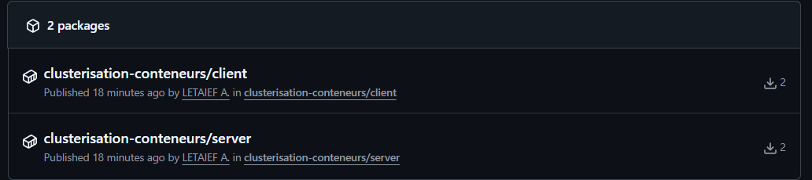
</p>

## Exercice 2 : création du cluster Docker Swarm

### 2.1 Lancer les 4 machines

Le fichier `swarm/compose.yml` crée 1 conteneur `manager` et 3 conteneurs `node1`, `node2`, `node3`, tous avec l'image `docker:dind`.

- `privileged: true` : indispensable pour faire tourner Docker dans un conteneur. En contrepartie, le conteneur n'est plus isolé du système.
- `hostname` : donne à chaque machine un nom lisible, qu'on retrouvera dans la liste des nœuds.

```bash
cd swarm
docker compose up -d
docker ps
```

<p align="center">
  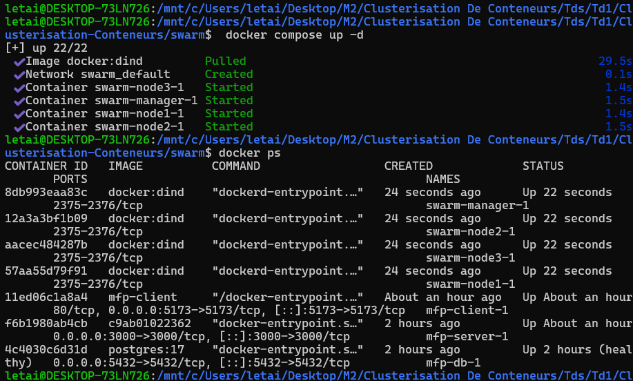
</p>

Nos 4 machines `swarm-manager-1`, `swarm-node1-1`, `swarm-node2-1` et `swarm-node3-1` sont `Up`, à côté des conteneurs de l'application du TD1.

Reste à vérifier que Docker fonctionne bien **à l'intérieur** :

```bash
docker compose exec manager docker ps
docker compose exec node1 docker ps
```

<p align="center">
  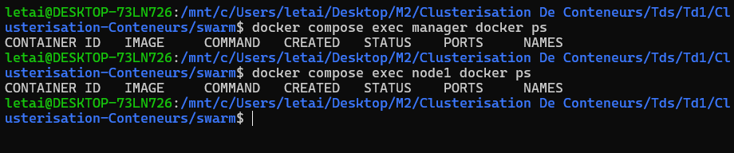
</p>

`docker ps` répond, avec une liste **vide** : chaque conteneur a bien son propre Docker, indépendant de celui du PC.
<br/>Les conteneurs de l'application, pourtant bien présents sur le PC, n'y apparaissent pas.

### 2.2 Initialiser le cluster

```bash
docker compose exec manager docker swarm init
```

<p align="center">
  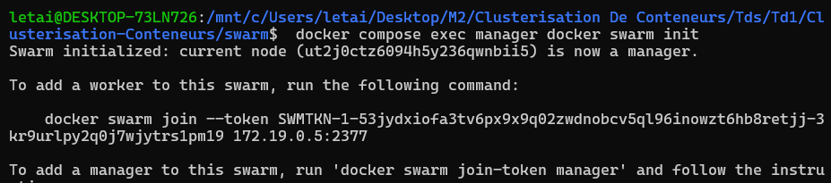
</p>

Le conteneur `manager` devient le **manager**, autrement dit le chef du cluster.
<br/>Docker nous donne au passage la commande `docker swarm join` et son **token** (`SWMTKN-1-…`) : c'est le sésame dont les nœuds auront besoin pour rejoindre le cluster.

### 2.3 Faire rejoindre les nœuds

```bash
TOKEN=$(docker compose exec manager docker swarm join-token -q worker)
docker compose exec node1 docker swarm join --token $TOKEN manager:2377
docker compose exec node2 docker swarm join --token $TOKEN manager:2377
docker compose exec node3 docker swarm join --token $TOKEN manager:2377
```

- `join-token -q worker` : range le token dans la variable `TOKEN`, ce qui évite de le recopier à la main.
- `manager:2377` : les nœuds retrouvent le manager par le **nom de son service**, pas par son adresse IP.

<p align="center">
  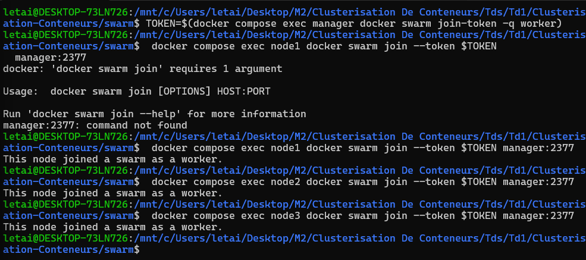
</p>

Chaque nœud répond `This node joined a swarm as a worker.` : `node1`, `node2` et `node3` font désormais partie du cluster, comme **workers**.

### 2.4 Lister les nœuds du cluster

On entre dans le conteneur `manager`, et on lui demande la liste des nœuds :

```bash
docker compose exec manager ash
docker node ls
exit
```

<p align="center">
  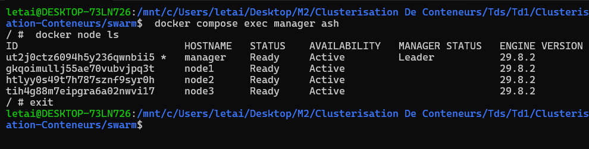
</p>

Le cluster compte bien **4 nœuds**, tous `Ready` et `Active` :
- `manager` est le **Leader** : c'est lui qui pilote le cluster (l'étoile `*` signale le nœud sur lequel on a tapé la commande).
- `node1`, `node2` et `node3` sont des **workers** : ce sont eux qui font tourner les conteneurs.

## Exercice 3 : tests du cluster

### 3.1 Créer une stack `hello-world`

Fichier `swarm/hello-world.compose.yml` :

```yaml
services:
  hello:
    image: hello-world
    deploy:
      replicas: 2
```

- Une **stack**, c'est un fichier au format Docker Compose qu'on déploie sur le cluster avec `docker stack deploy`.
- La partie `deploy` n'existe que pour Swarm : `replicas: 2` lui demande de faire tourner **2 copies** du conteneur, réparties sur les nœuds.

### 3.2 Copier la stack dans le manager

D'abord, on ajoute un **volume anonyme** sur `/home/manager` au service `manager` (`swarm/compose.yml`). Comme ça, les fichiers rangés dans ce dossier ne disparaissent pas si le conteneur est recréé :

```yaml
  manager:
    image: docker:dind
    hostname: manager
    privileged: true
    volumes:
      - /home/manager
```

Ensuite, on recrée le manager, on s'assure que le cluster n'a pas bougé, et on y dépose la stack :

```bash
docker compose up -d manager
docker compose exec manager docker node ls
docker compose exec manager mkdir -p /home/manager
docker compose cp hello-world.compose.yml manager:/home/manager/
docker compose exec manager ls /home/manager
```

<p align="center">
  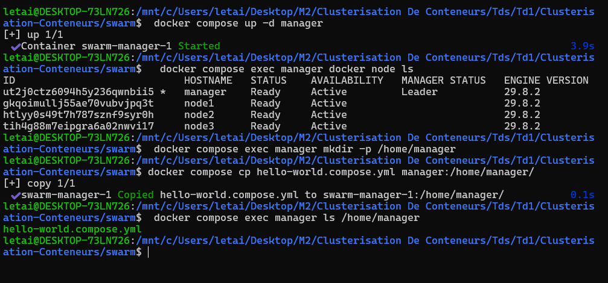
</p>

- Même après sa recréation, le manager voit toujours ses 4 nœuds `Ready` : le cluster a tenu le coup.
- `docker compose cp` copie le fichier du PC vers le conteneur, et `ls` confirme qu'il est bien arrivé dans `/home/manager`.

### Redémarrage du cluster

Après un redémarrage du PC, on retrouve nos 4 conteneurs arrêtés. On les relance :

```bash
docker compose start
docker compose exec manager docker node ls
```

<p align="center">
  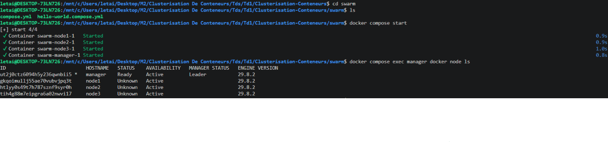
</p>

> **Problème rencontré :** `node1`, `node2` et `node3` restent bloqués en `Unknown`, puis passent à `Down`.
> <br/>En redémarrant, les conteneurs ont changé d'**adresse IP** (le manager est passé de `172.19.0.5` à `172.19.0.2`). Or Swarm retient l'adresse IP du manager, pas son nom : les nœuds frappaient donc à la mauvaise porte.
> <br/>**Solution :** quitter l'ancien cluster et en recréer un, avec les mêmes commandes qu'aux questions 2.2 et 2.3.

```bash
docker compose exec node1 docker swarm leave --force
docker compose exec node2 docker swarm leave --force
docker compose exec node3 docker swarm leave --force
docker compose exec manager docker swarm leave --force

docker compose exec manager docker swarm init
TOKEN=$(docker compose exec manager docker swarm join-token -q worker)
docker compose exec node1 docker swarm join --token $TOKEN manager:2377
docker compose exec node2 docker swarm join --token $TOKEN manager:2377
docker compose exec node3 docker swarm join --token $TOKEN manager:2377

docker compose exec manager docker node ls
```

<p align="center">
  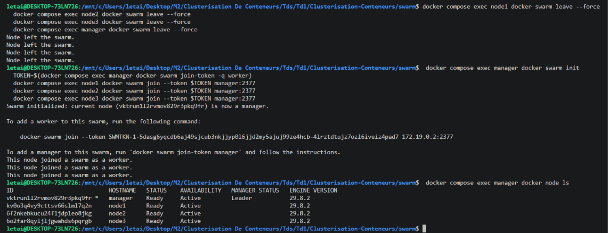
</p>

Tout est rentré dans l'ordre : les 4 nœuds sont de nouveau `Ready`, et `manager` a repris sa place de `Leader`.

### 3.3 Déployer la stack et observer le cluster

Depuis le manager, on déploie la stack sous le nom `hello`, puis on regarde ce que devient le service :

```bash
docker compose exec manager docker stack deploy -c /home/manager/hello-world.compose.yml hello
docker compose exec manager docker service ls
docker compose exec manager docker service ps hello_hello
```

<p align="center">
  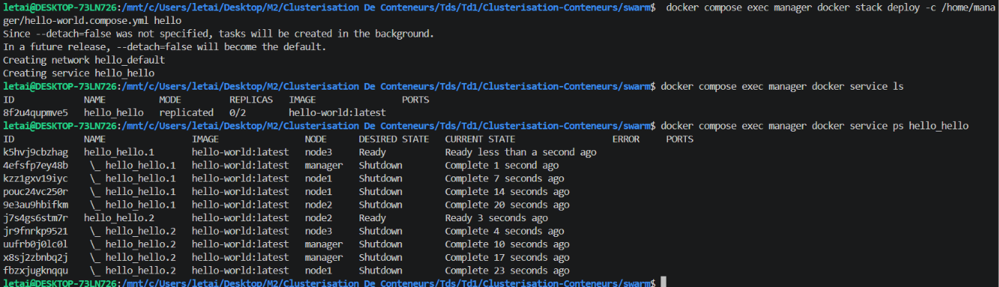
</p>

- `stack deploy` crée le réseau `hello_default` et le service `hello_hello` (le nom de la stack, suivi du nom du service).
- `service ls` : la colonne **REPLICAS** se lit « copies en cours / copies demandées ». Ici, `0/2` : on en a demandé 2, mais aucune ne tourne à cet instant précis.
- `service ps` raconte l'histoire des 2 copies : chaque conteneur se termine (`Complete`) au bout de quelques secondes, puis Swarm en relance un autre, à chaque fois sur un nœud différent, `manager` compris.

Pour voir la colonne REPLICAS « au complet », on lance à côté un service qui, lui, reste allumé : 3 copies de **nginx**.

```bash
docker compose exec manager docker service create --name web --replicas 3 nginx:alpine
docker compose exec manager docker service ls
```

<p align="center">
  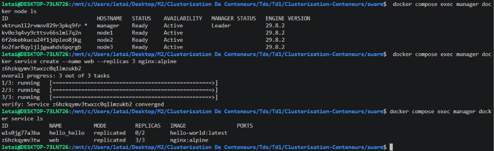
</p>

La différence saute aux yeux :
- `hello_hello` reste à `0/2` : ses conteneurs s'arrêtent dès qu'ils ont affiché leur message.
- `web` affiche `3/3` : les 3 copies de nginx demandées tournent toutes, et Swarm les garde allumées.

Une fois la démonstration faite, on supprime ce service avec `docker compose exec manager docker service rm web`.

On va ensuite voir ce qui s'est passé sur chaque machine :

```bash
docker compose exec manager docker ps -a
docker compose exec node1 docker ps -a
docker compose exec node2 docker ps -a
docker compose exec node3 docker ps -a
```

On ajoute `-a` pour voir aussi les conteneurs arrêtés : `hello-world` s'éteint presque aussitôt, un simple `docker ps` serait donc vide la plupart du temps.

<p align="center">
  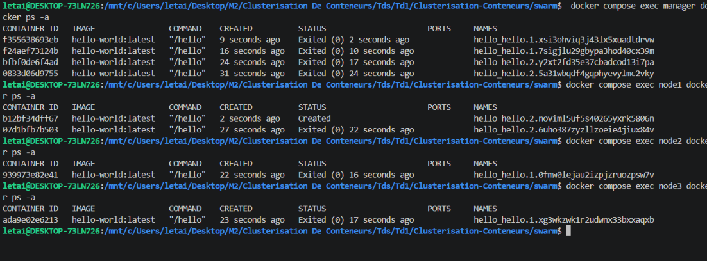
</p>

**Ce qu'on en déduit :**
- Les conteneurs sont **éparpillés sur toutes les machines**, y compris le `manager` : par défaut, le chef du cluster met lui aussi la main à la pâte.
- Chaque machine ne voit **que ses propres conteneurs** : c'est Swarm, depuis le manager, qui décide où va chaque copie.
- `hello-world` s'arrête de lui-même (`Exited (0)`, donc sans erreur). Mais `replicas: 2` réclame 2 copies **en permanence** : Swarm les relance donc sans arrêt. D'où le `0/2`, et tous ces conteneurs terminés qui s'empilent.

### 3.4 Faire varier la clause `deploy`

Pour chaque essai, on suit la même routine : on supprime la stack (`docker stack rm hello`), on copie le nouveau fichier dans le manager, et on redéploie.

#### Sur le manager uniquement (par rôle)

Fichier `swarm/hello-world-manager.compose.yml` :

```yaml
services:
  hello:
    image: hello-world
    deploy:
      replicas: 2
      placement:
        constraints:
          - node.role == manager
```

```bash
docker compose exec manager docker stack rm hello
docker compose cp hello-world-manager.compose.yml manager:/home/manager/
docker compose exec manager docker stack deploy -c /home/manager/hello-world-manager.compose.yml hello
docker compose exec manager docker service ps hello_hello
```

<p align="center">
  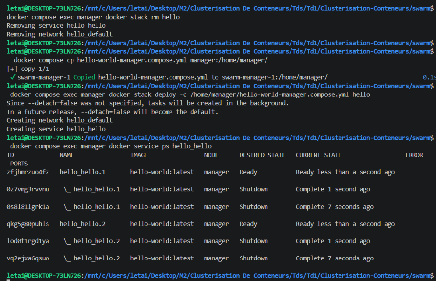
</p>

- `node.role == manager` : on interdit à Swarm de placer les conteneurs ailleurs que sur un nœud **manager**.
- `service ps` le confirme : toutes les copies tournent sur `manager`, et aucune sur `node1`, `node2` ou `node3`.

#### Sur tous les nœuds (`global`)

Fichier `swarm/hello-world-global.compose.yml` :

```yaml
services:
  hello:
    image: hello-world
    deploy:
      mode: global
```

```bash
docker compose exec manager docker stack rm hello
docker compose cp hello-world-global.compose.yml manager:/home/manager/
docker compose exec manager docker stack deploy -c /home/manager/hello-world-global.compose.yml hello
docker compose exec manager docker service ls
docker compose exec manager docker service ps hello_hello
```

<p align="center">
  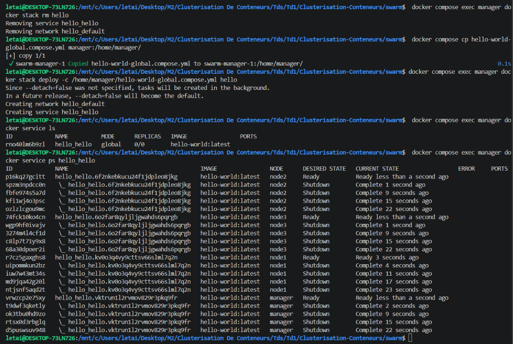
</p>

- `service ls` affiche le mode `global` : on ne choisit plus de nombre de copies, Swarm en place une par nœud.
- `service ps` le montre bien : **une copie par nœud**, sur `manager`, `node1`, `node2` et `node3`. Chaque copie porte d'ailleurs l'identifiant de son nœud dans son nom.
- Et si un nouveau nœud rejoint le cluster, Swarm y lance automatiquement sa copie.

---

# TD3

**Objectif :** placer un **reverse proxy**, Traefik, devant notre cluster Swarm.
<br/>Au lieu de retenir un port par application (`:8080`, `:8081`…), on tape une simple adresse comme `whoami.swarm.localhost` : Traefik lit le nom demandé par le navigateur et envoie la requête vers la bonne application.

## Exercice 1 : déployer Traefik

### 1.1 Relancer le cluster

On repart du cluster du TD2 (1 manager et 3 nœuds).
<br/>Seule nouveauté : le navigateur du PC doit pouvoir joindre Traefik, qui tournera dans le manager. On publie donc le port **80** du manager dans `swarm/compose.yml` :

```yaml
  manager:
    image: docker:dind
    hostname: manager
    privileged: true
    ports:
      - "80:80" # Traefik, reachable from the host browser
    volumes:
      - /home/manager
```

```bash
docker compose up -d
docker compose exec manager docker node ls
```

<p align="center">
  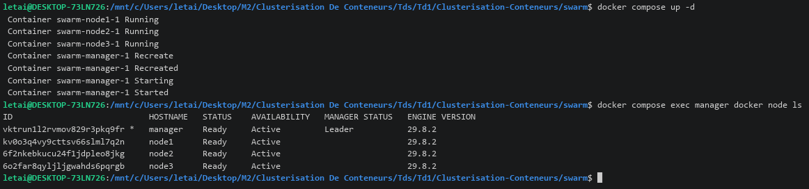
</p>

- `up -d` ne touche pas aux 3 nœuds (`Running`) et recrée seulement le manager (`Recreated`), pour lui ajouter le port 80.
- Après quelques secondes, `node ls` montre les **4 nœuds `Ready`**, avec `manager` toujours `Leader` : le cluster est prêt.

### 1.2 Déployer Traefik sur le manager

La stack fournie par le professeur est rangée dans `swarm/traefik.compose.yml`, sans modification. Elle contient 2 services :

```yaml
services:
  traefik:
    image: traefik:v3.6
    networks:
      # Connect to the 'web' overlay network for inter-container communication across nodes
      - web
    ports:
      - 80:80 # HTTP
      # - 443:443   # HTTPS - Would work only on a server
    volumes:
      - /var/run/docker.sock:/var/run/docker.sock:ro # Swarm API socket
    command:
      # HTTP EntryPoint
      - "--entrypoints.web.address=:80"
      # Enable the Docker Swarm provider (instead of Docker provider)
      - "--providers.swarm.endpoint=unix:///var/run/docker.sock"
      # Watch for Swarm service changes (requires socket access)
      - "--providers.swarm.watch=true"
      # Recommended: Don't expose services by default; require explicit labels
      - "--providers.swarm.exposedbydefault=false"
      # Specify the default network for Traefik to connect to services
      - "--providers.swarm.network=web"
      # API & Dashboard
      - "--api.dashboard=true" # Enable the dashboard
      - "--api.insecure=true" # Explicitly disable insecure API mod
      # Observability
      - "--log.level=INFO" # Set the Log Level e.g INFO, DEBUG
      - "--accesslog=true" # Enable Access Logs
      # - "--metrics.prometheus=true" # Enable Prometheus
    deploy:
      mode: replicated
      replicas: 1
      placement:
        # Placement constraints restrict where Traefik tasks can run.
        # Running on manager nodes is common for accessing the Swarm API via the socket.
        constraints:
          - node.role == manager
      # Traefik Dynamic configuration via labels
      # In Swarm, labels on the service definition configure Traefik routing for that service.
      labels:
        - "traefik.enable=true"
        # Dashboard router
        - "traefik.http.routers.dashboard.rule=Host(`traefik.swarm.localhost`)"
        - "traefik.http.routers.dashboard.entrypoints=web"
        - "traefik.http.routers.dashboard.service=api@internal"
        - "traefik.http.services.dashboard.loadbalancer.server.port=8080"

  # Deploy the Whoami application
  whoami:
    image: traefik/whoami
    networks:
      - web
    deploy:
      labels:
        - "traefik.enable=true"
        - "traefik.http.routers.whoami.rule=Host(`whoami.swarm.localhost`)"
        - "traefik.http.routers.whoami.entrypoints=web"
        - "traefik.http.services.whoami.loadbalancer.server.port=80"

# Define the overlay network for Swarm
networks:
  web:
    external: true
```

**Le service `traefik`**, notre reverse proxy :
- il écoute sur le port **80** (`entrypoints.web.address=:80`) ;
- il lit le socket Docker (`/var/run/docker.sock`) pour découvrir tout seul les services du cluster (`providers.swarm`) ;
- `exposedbydefault=false` : un service n'est publié que s'il le demande lui-même, avec le label `traefik.enable=true` ;
- `node.role == manager` : il tourne forcément sur le manager, le seul nœud qui connaît tout le cluster (et le seul dont on a publié le port 80) ;
- ses propres labels publient son **tableau de bord** sur `traefik.swarm.localhost`.

**Le service `whoami`**, une petite application de test qui affiche des infos sur la requête reçue. Il n'expose **aucun port** : il se présente à Traefik avec ses labels.
- `traefik.http.routers.whoami.rule=Host(...)` : « envoie-moi les requêtes qui arrivent pour `whoami.swarm.localhost` » ;
- `traefik.http.services.whoami.loadbalancer.server.port=80` : « je réponds sur mon port 80 ».

Les deux services se branchent sur le réseau `web`, déclaré `external: true` : la stack ne le crée pas, il doit donc exister **avant** le déploiement.
<br/>On le crée en mode **overlay** : un réseau qui s'étend sur tous les nœuds du cluster. Traefik, sur le manager, peut ainsi parler à un conteneur placé sur n'importe quel autre nœud.

```bash
docker compose exec manager docker network create --driver overlay web
docker compose exec manager docker network ls --filter name=web
```

<p align="center">
  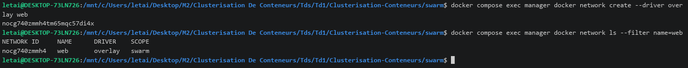
</p>

Le réseau `web` existe, avec le driver `overlay` et la portée `swarm` : il est bien partagé par tout le cluster.

On fait d'abord le ménage du TD2 (`docker compose exec manager docker stack rm hello` et `docker compose exec manager docker service rm web`), puis on copie la stack dans le manager et on la déploie :

```bash
docker compose cp traefik.compose.yml manager:/home/manager/
docker compose exec manager docker stack deploy -c /home/manager/traefik.compose.yml traefik
docker compose exec manager docker service ls
```

<p align="center">
  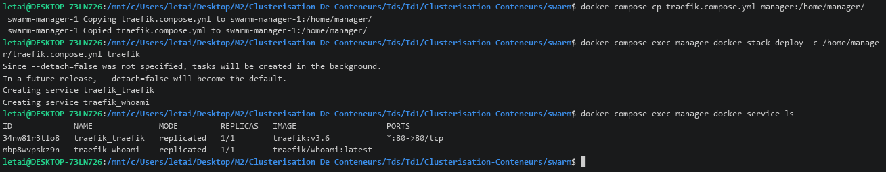
</p>

- `stack deploy` crée les 2 services `traefik_traefik` et `traefik_whoami`.
- Le temps de télécharger les images, `traefik_traefik` reste quelques secondes à `0/1`, puis les 2 services passent à **`1/1`**.
- Seul Traefik publie un port (`*:80->80/tcp`) : `whoami` reste caché derrière lui.

### 1.3 Accéder à Traefik depuis le navigateur

On travaille en local : aucun vrai nom de domaine ne pointe vers notre PC.
<br/>On passe donc par le **fichier hosts**, une sorte de mini-DNS interne à l'ordinateur, consulté en priorité et pris en compte immédiatement.
<br/>Sous Windows, il se trouve dans `C:\Windows\System32\drivers\etc\hosts` (il faut l'ouvrir en administrateur). On y ajoute nos 2 adresses, qui pointent vers notre propre machine :

```
127.0.0.1   traefik.swarm.localhost
127.0.0.1   whoami.swarm.localhost
```

<p align="center">
  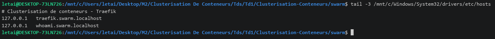
</p>

Le trajet d'une requête est alors le suivant : le navigateur demande `whoami.swarm.localhost` → le fichier hosts répond `127.0.0.1` → le port 80 du PC mène au port 80 du manager → Traefik lit le nom demandé et transmet au bon conteneur.

**Le tableau de bord de Traefik**, sur http://traefik.swarm.localhost :

<p align="center">
  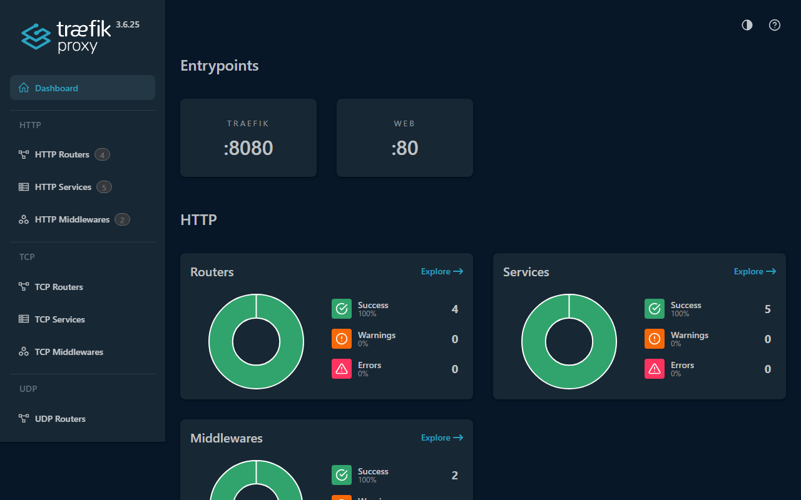
</p>

On y retrouve le point d'entrée `web` sur le port **80**, et les routeurs et services découverts tout seuls grâce aux labels, sans aucune erreur.

**L'application whoami**, sur http://whoami.swarm.localhost :

<p align="center">
  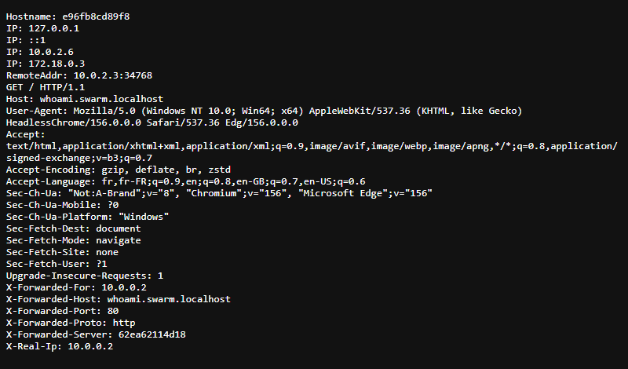
</p>

whoami nous renvoie le détail de la requête qu'elle a reçue :
- `Host: whoami.swarm.localhost` : c'est grâce à cet en-tête que Traefik a su vers quelle application envoyer la requête.
- Les en-têtes `X-Forwarded-…` sont ajoutés par Traefik : la requête est bien passée par le reverse proxy avant d'arriver au conteneur.
- Les adresses en `10.0.x.x` sont celles du réseau overlay `web`.

La suite du TD3 (exercice 2 : l'application de vote) se trouve dans [`voting-app/README.md`](../voting-app/README.md).
