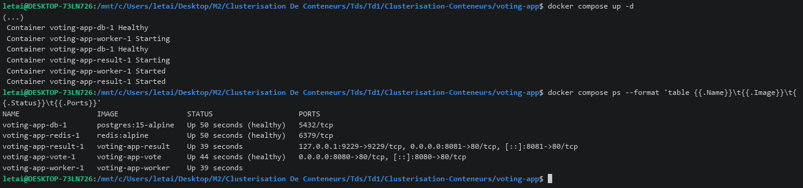
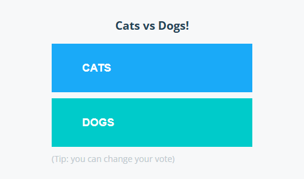
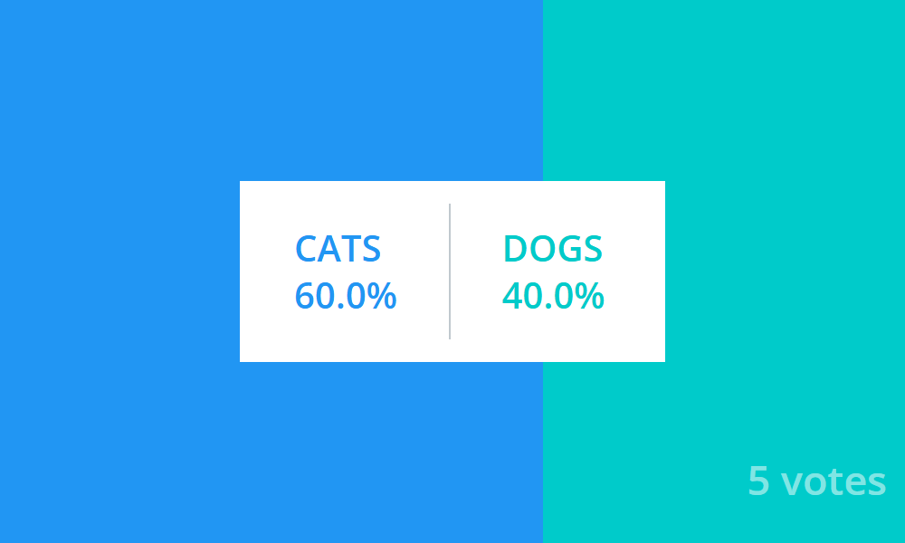
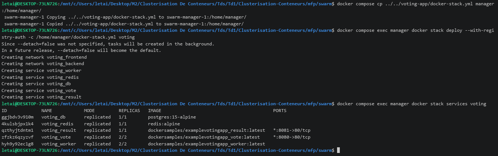
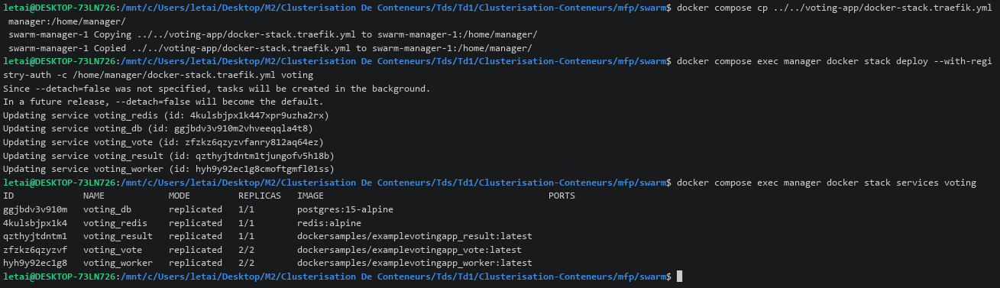
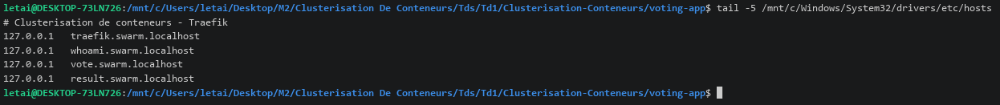
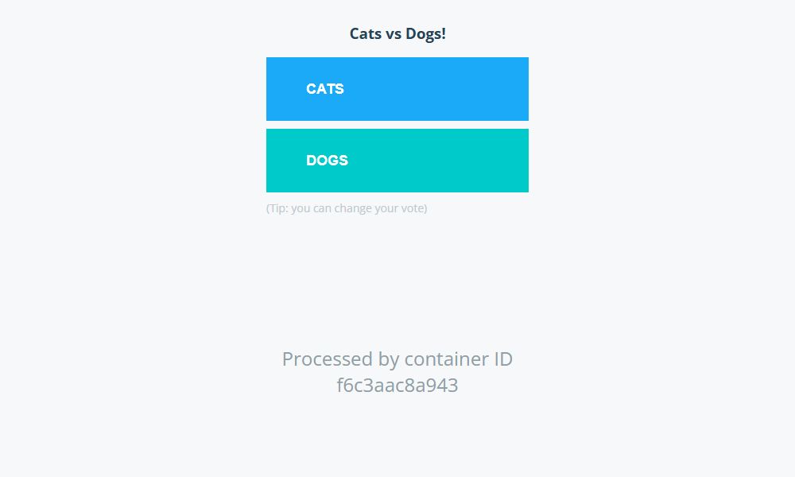

# Voting App : Clusterisation de conteneurs

Deuxième application du module **Clusterisation de conteneurs** (ESGI Lyon, 5ESGI AL + IABD).
<br/>Le but : faire tourner une application de vote, d'abord avec Docker Compose, puis sur notre cluster Docker Swarm, derrière Traefik.

Ce document fait suite à l'[exercice 1 du TD3](../mfp/README.md#exercice-1--déployer-traefik), où Traefik a été déployé sur le cluster.
<br/>Retour au [sommaire général](../README.md).

## Sommaire

**TD3**

- [Exercice 2 : déployer une autre application](#exercice-2--déployer-une-autre-application)

## Structure du dossier

```
voting-app/
├── vote/                 # site de vote (Python)
├── result/               # site des résultats (Node.js)
├── worker/               # traitement des votes (.NET)
├── healthchecks/         # scripts de vérification de redis et de la base
├── docker-compose.yml    # lancement en local
├── docker-stack.yml      # stack pour Docker Swarm
├── screenshots/          # captures d'écran
└── TD3.md                # ce document
```

---

# TD3

## Exercice 2 : déployer une autre application

### 2.1 Tester l'application avec Docker Compose

L'application est découpée en 5 services :

- `vote` : le site sur lequel on vote, entre **Cats** et **Dogs**. Chaque vote est envoyé dans redis.
- `redis` : une file d'attente, où les votes patientent avant d'être traités.
- `worker` : il récupère les votes dans redis et les enregistre dans la base.
- `db` : la base PostgreSQL, qui garde tous les votes.
- `result` : le site qui lit la base et affiche les résultats en direct.

Le fichier `docker-compose.yml` sépare ces services sur 2 réseaux : `front-tier` pour les sites, `back-tier` pour redis, le worker et la base.
<br/>Les sites sont publiés sur 2 ports : **8080** pour le vote et **8081** pour les résultats.

On lance tout depuis le dossier `voting-app/` :

```bash
docker compose up -d
docker compose ps --format 'table {{.Name}}\t{{.Image}}\t{{.Status}}\t{{.Ports}}'
```

> **Problème rencontré :** la première tentative s'arrête sur `429 Too Many Requests`.
> <br/>Docker Hub limite le nombre de téléchargements d'images sans compte, et nous en avions déjà fait beaucoup.
> <br/>**Solution :** se connecter à Docker Hub avec `docker login`, puis relancer `docker compose up -d`.

<p align="center">
  
</p>

- `up -d` construit les images de `vote`, `result` et `worker`, puis démarre les 5 conteneurs. La construction est longue : on ne garde ici que la fin de la sortie.
- `ps` montre les 5 conteneurs `Up`. Redis et la base sont `healthy` : leurs scripts de vérification répondent.
- Seuls `vote` (port 8080) et `result` (port 8081) sont accessibles depuis le PC.

**Le site de vote**, sur http://localhost:8080 :

<p align="center">
  
</p>

On vote une fois pour **Cats**. Ici, on passe par `curl`, ce qui revient à cliquer sur le bouton :

```bash
curl -X POST -d vote=a http://localhost:8080/
```

**Le site des résultats**, sur http://localhost:8081 :

<p align="center">
  
</p>

Le vote apparaît : **1 vote**, 100 % pour Cats.
<br/>Il a fait tout le trajet : le site de vote l'a posé dans redis, le worker l'a enregistré dans la base, et le site des résultats l'a lu.

Une fois le test terminé, on arrête l'application avec `docker compose down`.

### 2.2 Déployer l'application sur le cluster Swarm

Pour Swarm, on utilise le fichier `docker-stack.yml`. Il décrit les mêmes 5 services, avec 2 différences :
- les images de `vote`, `result` et `worker` sont déjà publiées sur Docker Hub : Swarm ne sait pas construire d'images, il les télécharge ;
- la partie `deploy` demande **2 copies** de `vote` et de `worker`.

On se place dans `mfp/swarm`, là où se trouve notre cluster.
<br/>Les nœuds aussi téléchargent des images sur Docker Hub : on se connecte donc dans le manager (`docker compose exec manager docker login`), et on déploie avec `--with-registry-auth`, qui transmet cette connexion aux autres nœuds.

```bash
docker compose cp ../../voting-app/docker-stack.yml manager:/home/manager/
docker compose exec manager docker stack deploy --with-registry-auth -c /home/manager/docker-stack.yml voting
docker compose exec manager docker stack services voting
```

<p align="center">
  
</p>

- `stack deploy` crée les 2 réseaux `voting_frontend` et `voting_backend`, puis les 5 services.
- Après une minute environ, le temps de télécharger les images sur chaque nœud, tous les services sont au complet : `2/2` pour `vote` et `worker`, `1/1` pour les autres.
- Les sites restent publiés sur les ports **8080** et **8081**, mais à l'intérieur du cluster : rien ne les relie encore au PC. C'est ce qu'on règle avec Traefik à la question suivante.

### 2.3 Publier le vote et les résultats avec Traefik

On s'inspire du service `whoami` de l'exercice 1. On écrit une nouvelle version de la stack, `docker-stack.traefik.yml`, où seuls `vote` et `result` changent :

```yaml
  vote:
    image: dockersamples/examplevotingapp_vote
    networks:
      - frontend
      - web
    deploy:
      replicas: 2
      labels:
        - "traefik.enable=true"
        - "traefik.http.routers.vote.rule=Host(`vote.swarm.localhost`)"
        - "traefik.http.routers.vote.entrypoints=web"
        - "traefik.http.services.vote.loadbalancer.server.port=80"

  result:
    image: dockersamples/examplevotingapp_result
    networks:
      - backend
      - web
    deploy:
      labels:
        - "traefik.enable=true"
        - "traefik.http.routers.result.rule=Host(`result.swarm.localhost`)"
        - "traefik.http.routers.result.entrypoints=web"
        - "traefik.http.services.result.loadbalancer.server.port=80"

networks:
  frontend:
  backend:
  web:
    external: true
```

- Les 2 services rejoignent le réseau `web`, celui de Traefik. Sans ça, Traefik ne pourrait pas leur parler.
- Leurs labels indiquent à Traefik l'adresse de chaque site, et le port sur lequel il répond (**80**).
- Les ports `8080` et `8081` disparaissent : c'est maintenant Traefik qui fait l'entrée.

On redéploie avec le même nom de stack, `voting`. Swarm met alors à jour les services existants au lieu d'en créer de nouveaux :

```bash
docker compose cp ../../voting-app/docker-stack.traefik.yml manager:/home/manager/
docker compose exec manager docker stack deploy --with-registry-auth -c /home/manager/docker-stack.traefik.yml voting
docker compose exec manager docker stack services voting
```

<p align="center">
  
</p>

- `stack deploy` affiche `Updating service` pour chacun des 5 services.
- Tous les services sont de nouveau au complet, et la colonne **PORTS** est vide : plus aucun port n'est publié.

Il reste à ajouter les 2 nouvelles adresses dans le fichier hosts :

```
127.0.0.1   vote.swarm.localhost
127.0.0.1   result.swarm.localhost
```

<p align="center">
  
</p>

**Le site de vote**, sur http://vote.swarm.localhost :

<p align="center">
  
</p>

On vote une nouvelle fois pour **Cats**, avec `curl -X POST -d vote=a http://vote.swarm.localhost/`.

**Le site des résultats**, sur http://result.swarm.localhost :

<p align="center">
  
</p>

Le vote apparaît : **1 vote**, 100 % pour Cats.
<br/>La base du cluster est neuve, d'où un seul vote, et non 2 avec celui du test en local.
<br/>Les 2 sites sont donc accessibles depuis le PC, chacun à sa propre adresse, sans retenir aucun port.
